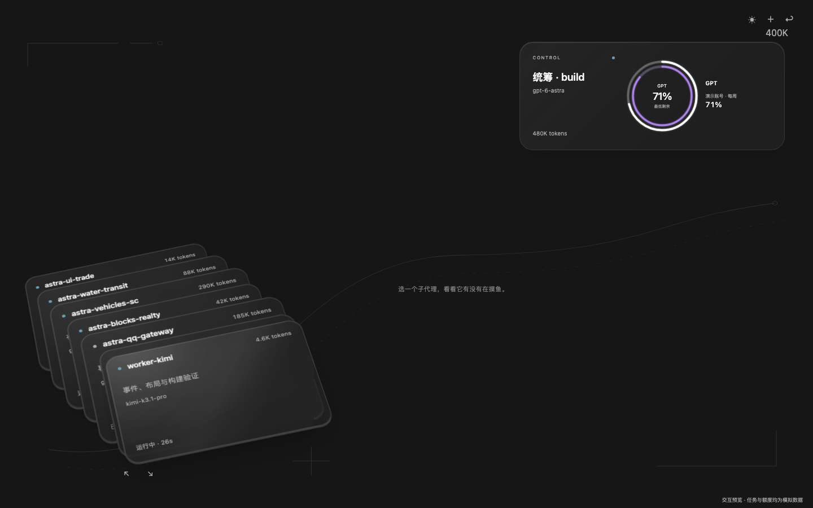

# Agent Radar

[中文](README.md) · [Downloads](https://github.com/YuYiChyan/opencode-agent-radar/releases/latest) · [Issues](https://github.com/YuYiChyan/opencode-agent-radar/issues)

A native OpenCode Desktop plugin for watching your agent team: frosted-glass card decks, focused collaboration graphs, real activity events, and optional AI analysis and quota rings.

## Install

```sh
opencode plugin add github:YuYiChyan/opencode-agent-radar
```

Open a Desktop session and use `/radar` or the **总控台 ↗** button in its header. The repository includes the prebuilt GUI bundle, so installation does not require building the source.

```sh
opencode plugin update github:YuYiChyan/opencode-agent-radar
```

**Target:** OpenCode Desktop / SDK **2.2.7**. The GUI API is experimental. Native loading has been verified on macOS; native Windows/Linux acceptance and other OpenCode versions are not yet verified. The current interface is in Chinese.

Basic monitoring requires no API key. AI analysis is off by default.



Screenshots use a development preview with simulated tasks and quota values. The installed plugin reads your own sessions and connected quota sources.

## Features

- Native fullscreen and sidebar views, with no separate browser window or web server.
- Hover to gently extract a card, with soft lighting and translucent frosted glass.
- Select a card to replace the controller in the top slot and reveal its relationships. Select it again to collapse.
- Circular deck navigation with the wheel, arrows, or keyboard.
- Automatically centered, fitted relationship graphs without scrollbars; draggable nodes and layout reset.
- OpenCode theme inheritance, including custom colors and light/dark mode.
- Actual agent/model identities, execution states, token counts, dispatches, reports, and verified file handoffs.
- Reduced-motion and reduced-transparency support.

The fullscreen shortcut is `⌘⇧J` on macOS. The sidebar is available through **＋ → 总控台 · Agent Radar**. Escape closes the selected view/fullscreen as appropriate.

## Evidence and optional AI analysis

Observed relationships come from native events or verified persisted tool records. Semantic AI relationships are inferred and drawn with dashed lines. Historical recovery uses bounded public assistant text and explicit subagent tool records; it does not replay history as live animation or use user messages or reasoning content.

In **Settings → Agent Radar**, choose an existing OpenCode provider/model, a custom OpenAI Chat Completions-compatible API, or leave analysis off. Saved user settings take precedence over initial plugin options.

When enabled, analysis sends public task/tool information, file paths and result summaries to the chosen model. Custom API keys are encrypted through the OS-backed secure-storage facility. The settings page displays only whether a key has been saved.

## Optional quota rings

With `@slkiser/opencode-quota` installed and configured, Agent Radar reads its existing snapshot cache. Rings only display numerical data that actually exists; missing sources are not fabricated. Without a quota source, the center displays session tokens.

Click a ring to inspect the accounts, periods, reset times and cache status. Agent Radar does not refresh providers, enforce quota cutoffs, or switch accounts.

## Manual ZIP installation

Download a ZIP from [Releases](https://github.com/YuYiChyan/opencode-agent-radar/releases), extract it to a permanent directory, and append that directory to `plugins` in your global `opencode.json(c)`:

```jsonc
{
  "$schema": "https://opencode.ai/config.json",
  "plugins": ["/absolute/path/to/agent-radar"]
}
```

Preserve your other plugin entries and settings. The path must point to the directory containing `package.json`; Windows can use a path such as `C:/Plugins/agent-radar`. The global config normally lives under `~/.config/opencode/`.

The desktop loads `dist/gui-experimental.cjs` directly. **Settings → Extensions → Plugins** shows its status and offers UI enable/disable and reload controls.

## Development

Use Node.js 22:

```sh
npm ci --ignore-scripts
npm run check
npm test
npm run build
npm run preview
```

The preview uses simulated task and quota fixtures and is excluded from the installable package. Unit suites cover event handling, history, graph layout, fitting, requests and ring presentation. UI acceptance was performed in Chromium preview; native host loading is a separate check.

Commit the rebuilt `dist/gui-experimental.cjs` when changing runtime code: Git-based installation depends on it. Keep the package name `agent-radar` aligned with its IPC identity.

## License

[MIT](LICENSE). Contributions are welcome.
